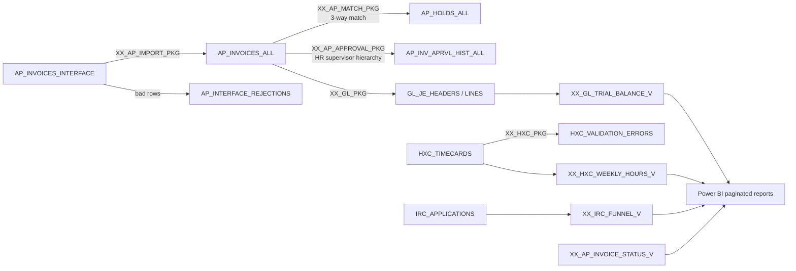

# oracle-ebs-finhr-lab

A hands-on lab that rebuilds core **Oracle E-Business Suite R12** back-office flows in
**Oracle SQL and PL/SQL**: Purchasing, Payables, General Ledger, HR, Time and Labor,
and iRecruitment. It uses EBS-style tables (`AP_INVOICES_ALL`, `PO_LINES_ALL`,
`GL_JE_LINES`, `PER_ALL_PEOPLE_F`, ...) and EBS naming for custom code (`XX_` prefix).

> This is a simplified learning model, not Oracle's product code. Table names follow
> EBS conventions so the patterns carry over to a real 12.2 instance.

## What it does



| Package | EBS equivalent | Rules |
|---|---|---|
| `XX_AP_IMPORT_PKG` | Payables Open Interface Import | required fields, inactive or unknown supplier, duplicate invoice, header vs. line total, PO and PO line checks |
| `XX_AP_MATCH_PKG` | Invoice Validation | 3-way match: billed vs. ordered (`QTY ORD`), billed vs. received (`QTY REC`), unit price over 2% tolerance (`PRICE`); re-validation clears holds |
| `XX_AP_APPROVAL_PKG` | AP approval via Oracle Workflow / AME | auto-approve ≤ $1,000; otherwise route up the HR supervisor chain (`CONNECT BY`) to the first approver whose limit covers the amount; approval history |
| `XX_GL_PKG` | Create Accounting + Journal Import + Posting | DR expense from PO charge account, CR AP liability; held or unapproved invoices skipped; posting blocked if out of balance |
| `XX_HXC_PKG` | Time and Labor time entry rules | > 24 hours per day, negative hours, dates outside the period; weekly overtime over 40 hours for non-exempt staff |

Reporting views feed Power BI: invoice status and holds, import exceptions, AP aging,
GL trial balance, weekly hours and overtime, and the iRecruitment applicant funnel.
See [reports/POWER_BI_GUIDE.md](reports/POWER_BI_GUIDE.md).

## Run it

Requires Docker. The script starts Oracle Database Free, installs everything, and runs the tests:

```bash
./scripts/run_local.sh            # KEEP_DB=1 ./scripts/run_local.sh to keep the DB for Power BI
```

Connection when kept: `ebslab / LabPassw0rd @ localhost:1521/FREEPDB1`.

## Tests and CI

`tests/run_tests.sql` runs the whole lifecycle on seeded data and checks each outcome:
3 invoices imported and 3 rejected (each for the right reason), holds placed and then
cleared after a new receipt, approval routed to the right manager, a balanced
$5,100 journal posted while the held invoice stays out of the GL, and timecard errors
and overtime computed correctly.

The same script runs in **Azure DevOps** (`azure-pipelines.yml`) and GitHub Actions
(`.github/workflows/ci.yml`) on every push and pull request.

## Layout

```
install.sql                 master install script (SQL*Plus)
sql/01_schema.sql           EBS-style tables
sql/02_seed.sql             scenario data (each row exercises one rule)
sql/03_reporting_views.sql  views for Power BI
plsql/*.sql                 XX_ packages
tests/run_tests.sql         end-to-end assertions
reports/POWER_BI_GUIDE.md   paginated report + dashboard build steps
docs/DESIGN.md              systems analysis notes
```
